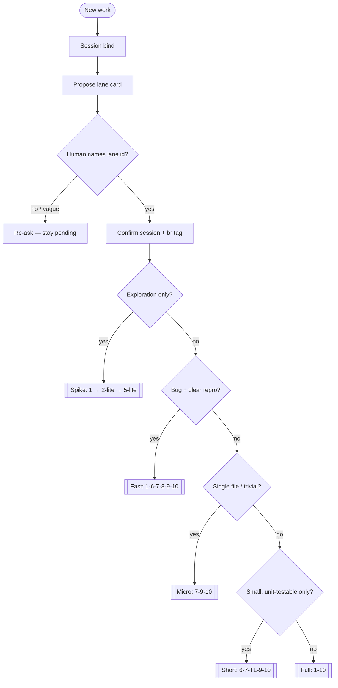
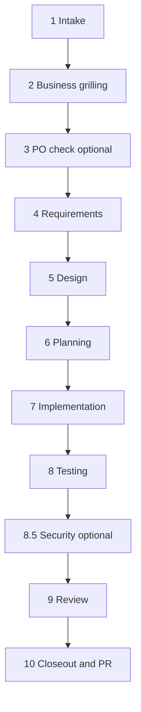
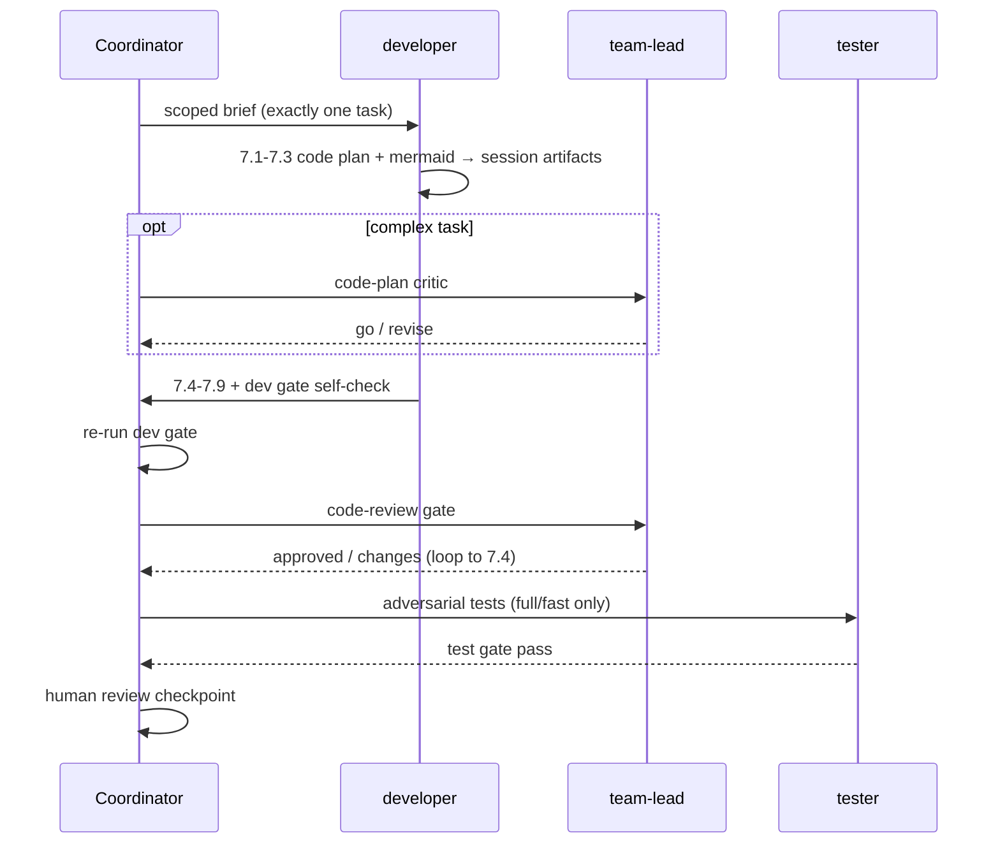

# SDLC Coordinator Playbook

> **Source of truth:** the canonical spec lives in this package's `docs/`. This skill is
> the **operational playbook**. Project-specific values (build/test commands, gate paths,
> tracker, PR provider, artifact paths) come from **`pipeline.manifest.json`** at the repo
> root — never hardcode stack assumptions.

Entry: **"Run SDLC for: {feature}"** or **`/sdlc {feature}`**. You are the **coordinator** —
all specialist agents talk only to you (hub-and-spoke).

## Preflight (block SDLC until all pass)

**Hard gate (FR-008):** do **not** dispatch specialists or run Spec Kit phase commands past
seed intake until **all** of the following succeed, in order:

1. **Ready manifest** — `pipeline.manifest.json` is present and healthy
2. **Session bound** — `_code_agent/{session}/state.json` exists with Spec Kit twin ids
3. **Lane confirmed** — human named a lane id; `lane_status=confirmed` and `flow` set
4. **Then** Spec Kit phase commands / confirmed-lane phase checklist

| Check | Pass when | On failure — stop and tell the human |
|-------|-----------|--------------------------------------|
| Manifest ready | `status == ready` | Run `agentic-tool install` (if missing) then **`.agents adapt`** (or `agentic-tool apply` after recommendation). Re-run when `status` is `needs_adapt` / not ready. |
| Catalog current | `catalog_version` matches `agentic-tool version` | Run `agentic-tool apply`, then `agentic-tool sync --host auto`, then `agentic-tool verify` (`rules/catalog-refresh.mdc`). |
| Spec Kit dir | If `spec_kit.enabled`, `.specify/` exists | Run `specify init . --integration cursor`. If Spec Kit unavailable → **SPEC-KIT DEGRADED** (still require session + lane). |
| Session bound | `_code_agent/{session}/state.json` with contract fields + twin ids | Create or resume the session (**Session bind** below) before any specialist. |
| Lane confirmed | `lane_status=confirmed` and `flow` set | Present **lane proposal card**; wait for explicit `spike\|micro\|short\|fast\|full`. Do not invent `flow`. |
| Verify (prefer) | `agentic-tool verify` / `verify-pipeline.ps1` clean or known WARN only | Fix named MISS errors (pack skills, beads rule, host projection) before advancing. |

**Order:** ready manifest → session bind → lane propose + wait → after confirm update
session + `br` tag → **then** Spec Kit `workflow.yml` steps for that lane.

Details for steps 2–3: **Session bind** and **Lanes** sections below.

## Session bind (before any specialist)

**Hard rule:** create or resume `_code_agent/{session}/` **before** dispatching BA, architect,
developer, or any other specialist. Spec Kit holds canonical `spec.md` / `plan.md` /
`tasks.md`; the session holds runtime control state (lane, phase, checkpoints, handoffs).

1. **Resolve session id** — resume if the human names one, or if a prior session matches the
   active Spec Kit feature (see twin ids below); otherwise create `YYYYMMDD-{slug}`.
2. **Ensure folder** — `_code_agent/{session}/` with `state.json`, `artifacts/`, and (via
   checkpoint CLI) step/event scaffolding as needed.
3. **Write required `state.json` fields** (contract:
   `specs/005-stable-flow-observability/contracts/session-state.schema.md`):

| Field | Required | Notes |
|-------|----------|-------|
| `session` | yes | Same as folder name |
| `feature_directory` | yes | e.g. `specs/NNN-slug` — Spec Kit feature path |
| `branch` | yes | Active git branch |
| `lane_status` | yes | Start at `pending_human_decision` until human confirms lane |
| `phase` | yes | e.g. `1-intake` |
| `owner_agent` | yes | Usually `coordinator` |
| `spec_kit` | yes | `{ enabled, feature_directory, constitution }` |
| `created` | yes | ISO date when session was created |
| `flow` | no | **Forbidden** until human confirms lane |
| `lane_decision_source` | no | Set only after confirm |

4. **Twin ids (session ↔ Spec Kit)**
   - Session → feature: `feature_directory` and `spec_kit.feature_directory` (same path).
   - Feature → session: keep `.specify/feature.json` pointing at the feature dir. To find the
     latest session for a feature, pick the `_code_agent/*` folder whose `state.json`
     `feature_directory` matches, with the newest `state.json` mtime (ask the human if
     several look active). Do **not** invent a prior lane or `flow` on resume.
5. **SPEC-KIT DEGRADED** — still create the session; set `spec_kit.enabled` false and store
   SDLC supplements only under `_code_agent/{session}/artifacts/`.

**Do not** write working REQ/SDD/plans only under `docs/sdlc/` during the run — session-first
artifacts; publish after Phase 9.

Checkpoint step lifecycle (`start` / `done` / `resume` / …) uses `agentic-tool checkpoint`;
the coordinator **writes Spec Kit bind fields** into `state.json` (Write tool or edit) —
see [agent-checkpoints.md](../../docs/reference/agent-checkpoints.md).

## Spec-Driven Development backbone (Spec Kit)

This pipeline runs on **GitHub Spec Kit**. Every phase drives the matching `/speckit.*`
command; `spec.md` / `plan.md` / `tasks.md` and the constitution are **canonical**. Full
playbook: [spec-kit skill](../spec-kit/SKILL.md); always-on `rules/spec-kit.mdc`.

**Canonical Spec Kit lane workflows:** `core/workflows/pipeline-{spike|micro|short|fast|full}/workflow.yml`
(installed to `.specify/workflows/pipeline-*` on apply). Upstream bundled `speckit` Full SDD
remains available as reference — **lane drivers are the `pipeline-*` packages** (009).

| Pipeline phase | `/speckit` command | Lane workflow step | Canonical artifact |
|----------------|--------------------|------------------------------|--------------------|
| adapt / intake | `constitution` | *(before workflow)* | `.specify/memory/constitution.md` |
| 1 Intake | branch `NNN-slug` + seed `specify` | `specify` | `specs/NNN-slug/spec.md` |
| 2 Grilling | `clarify` | *(pipeline extension)* | `spec.md` |
| 4 Requirements | `specify` | `specify` + `review-spec` | `spec.md` (+ REQ supplement) |
| 5 Design | `plan` + `checklist` | `plan` + `review-plan` | `plan.md` (+ SDD/TDD/ADR/contracts) |
| 6 Planning | `tasks` → `analyze` → `taskstoissues` | `tasks` | `tasks.md` (+ IMPLEMENTATION-PLAN) |
| 7 Implementation | `implement` (one task) | `implement` | code |
| 8 Testing | re-run `analyze` | *(pipeline extension)* | TEST report |
| 8→9 Convergence | `converge` (loop to `implement`) | *(pipeline extension)* | appended tasks until converged |

**Note:** `workflow.yml` `inputs.scope` (`full` / `backend-only` / `frontend-only`) is Spec Kit
**feature scope**, not our SDLC **lane** id. Lanes are confirmed separately (next section).

**Gate coupling:** `/speckit.analyze` (and `/speckit.checklist`) run **before** the matching
pipeline gate script as a machine pre-check. A gate never passes on a red `analyze`. Our
gate scripts remain authoritative. Spec Kit `type: gate` steps in `workflow.yml` align with
human review (Principle II). If Spec Kit is unavailable, announce **SPEC-KIT DEGRADED**
and fall back to hand-written SDLC docs with the same gates.

## Communication model

- **No peer links** between specialist agents. Route work, collect artifacts, run gates.
  On each hub→spoke dispatch, append an `agent_switch` event (see **Session events**).
- **Context scoping:** hand each agent a minimal brief (paths from `artifacts.json`, not
  full chat history).   For codebase discovery use **`code-search`** skill: semantic MCP first, then
  Grep/Glob/Read. Bulky content goes to
  `_code_agent/{session}/artifacts/` via `checkpoint save` / `link` — never paste code
  plans or gate logs in chat.
- **Checkpoints:** write `_code_agent/{YYYYMMDD-slug}/` on every step boundary. Resume with
  `checkpoint resume` (TOON + artifacts index); `read --max-chars` only when needed.

## Lanes — propose cheapest safe; never auto-select

Full decision tree and token rationale: [pipeline-flows.md](../../docs/reference/pipeline-flows.md).
Proposal card contract:
[`contracts/lane-proposal-card.md`](../../../specs/005-stable-flow-observability/contracts/lane-proposal-card.md).



| Lane | When | Skips | Spec Kit lane workflow | Session artifacts |
|------|------|-------|------------------------|-------------------|
| **Spike** | Explore approach; no shipped code | 3–4, 6–10 | `pipeline-spike` | `artifacts/spike/` |
| **Micro** | One-file trivial chore | 1–6, 8, 8.5 | `pipeline-micro` | `artifacts/tasks/{id}/code-plan.md` |
| **Short** | Small refactor; no API/data/infra/auth | 1–5, 8, 8.5 | `pipeline-short` | plan + code-plan |
| **Fast** | Bug with repro; no contract/data change | 2–5 | `pipeline-fast` | intake + plan |
| **Full** | Feature, contract, data, infra, auth | — | `pipeline-full` | all SDLC docs + code-plans |

### Lane proposal (MUST wait)

**Hard rules (FR-003):**

1. Agent **MAY** analyze and propose; agent **MUST NOT** silently select, assume, or tag a
   lane. Never write `flow:` / `lane_status=confirmed` until the human names a lane id.
2. “Just do it” / vague assent without a lane id → **re-ask**; stay
   `lane_status=pending_human_decision`.
3. Human may override the recommendation; proceed with their lane id (warn once if heavier
   than needed).

After **session bind**, before any specialist or Spec Kit phase command past seed intake:

1. Assess cheapest safe lane using the decision tree above.
2. Present a **lane proposal card** (required fields from the contract):

```text
Lane proposal
- Recommended: {lane} — {rationale}
- Alternatives: {lane} ({why}), …
- Relative cost: {phases/effort comparison — not token meters}
- Risks if wrong: {heavier/lighter failure modes}
Reply with one of: spike | micro | short | fast | full
```

3. **Stop and wait** for an explicit lane id (`spike` | `micro` | `short` | `fast` | `full`).
4. Only then run **After human lane confirm** (next subsection).

**How human lane confirm maps onto Spec Kit lane workflows:**

| After human confirms… | Start workflow package |
|-----------------------|------------------------|
| `full` | `pipeline-full` |
| `fast` | `pipeline-fast` |
| `short` | `pipeline-short` |
| `micro` | `pipeline-micro` |
| `spike` | `pipeline-spike` |

Lane confirm is a **pre-workflow human disposal**. Spec Kit `type: gate` steps inside
`pipeline-*` remain additional human checkpoints after the lane is confirmed.

### After human lane confirm

When the human replies with an explicit lane id:

1. Update `_code_agent/{session}/state.json`:
   - `lane_status` = `confirmed`
   - `flow` = `{lane}` (`spike` \| `micro` \| `short` \| `fast` \| `full`)
   - `lane_decision_source` =
     - `human_accepted_proposal` if they took the recommended lane
     - `human_override` if they chose a different lane
2. When tracker is beads: tag the active issue with **`flow:{lane}`** via `br`.
   **Never** use `bd`.
3. **Append** a typed line to `_code_agent/{session}/events.jsonl` (see **Session events**).
4. **Require Spec Kit readiness `ok`** (CLI + `.specify/`). If not ok → stop with
   `cli_missing` / `not_initialized` (or state **SPEC-KIT DEGRADED** and do **not**
   start `pipeline-*`).
5. **Start the lane workflow** (sole runner of `/speckit.*` for that run — no
   double-dispatch of specialists to re-run the same commands):

```bash
specify workflow run pipeline-{lane} -i spec="{feature brief}" -i integration=auto --json
```

6. Write twin into `state.json` (prefer CLI helper):

```bash
agentic-tool checkpoint workflow-set {session} pipeline-{lane} <run_id> running
# later / on pause-fail-complete:
agentic-tool checkpoint workflow-sync {session}
```

Equivalent JSON:

```json
"workflow": { "id": "pipeline-short", "run_id": "<from --json>", "status": "running" }
```

7. On gate pause: guide human to resume (chat, dashboard detail, or CLI):

```bash
specify workflow resume <run_id> -i <verdict_input>=approve --json
# or:
agentic-tool dashboard --detail . --resume-run <run_id> --resume-input <verdict_input>=approve
```

8. On mid-step **fail**: keep the same `run_id`; fix cause; `workflow resume` — do **not**
   auto-start a new run. Explicit human restart required for a new run. After resume, run
   `checkpoint workflow-sync {session}`.
9. **No mid-run lane switch** — finish/abort/restart current run before a new lane confirm.
10. Specialists remain hub-and-spoke for work **outside** workflow `command` steps
    (security sign-off, PR, tracker) and gate support only.

**Token-saving warning:** if the human requests **full** but a lighter lane qualifies, warn
once and wait for an explicit lane id (including confirming they still want `full`).

## Session events (`events.jsonl`, slice 2)

Append-only log at `_code_agent/{session}/events.jsonl`. One JSON object per line.
**Do not** store secrets. Prefer the typed schema (data-model); step lifecycle may also
emit legacy `{ts,phase,step,agent,event,summary}` lines via checkpoint `start`/`done`.

### Typed line shape

```json
{"at":"2026-07-20T12:00:00Z","type":"lane","agent":"coordinator","payload":{"flow":"short","lane_decision_source":"human_accepted_proposal"}}
```

| `type` | When | `payload` (minimum) |
|--------|------|---------------------|
| `lane` | After human lane confirm (with state.json update) | `flow`, `lane_decision_source` |
| `gate` | After coordinator re-runs a gate (pass or fail) | `gate`, `result` (`pass`\|`fail`); optional `task` |
| `agent_switch` | Before dispatching a specialist (hub→spoke) | `from`, `to` (agent ids); optional `phase` |
| `phase` | Optional phase boundary | `phase`, optional `summary` |

### How to append

```bash
# Preferred CLI (also dual-writes legacy + typed lines for `gate`)
agentic-tool checkpoint event {session} lane --agent coordinator '{"flow":"short","lane_decision_source":"human_accepted_proposal"}'
agentic-tool checkpoint gate {session} pass requirements
agentic-tool checkpoint event {session} agent_switch --agent coordinator '{"from":"coordinator","to":"developer","phase":"7"}'
```

Or append one JSON line with the Write/edit tool. Count `gate_fail` / typed `gate` fails
for loopback caps.

## Grilling vs critique

| Stage | Type | Agent |
|-------|------|-------|
| 2 | **Grill** — edge cases + functional options | `ba-analyst` (+ optional `grill-with-docs`) |
| 5 | **Grill** — design alternatives + ADR + **API contracts** (REST/GraphQL/gRPC) | `architect` (+ `grill-with-docs`, `openapi-contract`, `graphql-contract`, `grpc-contract`) |
| spike | **Grill** — explore options | coordinator + `grill-with-docs` |
| 6 | **Critique** — plan, DoR, parallel tracks | `team-lead` + human |
| 7.1–7.3 | **Grill + self-critique** — code plan + mermaid | `developer` |
| 7.3 opt | **Critique** — code plan review | `team-lead` (complex tasks) |
| 7→8 | **Critique** — code review | `team-lead` |
| 8 | **Critique** — adversarial tests | `tester` |
| 8.5 | **Critique** — security | `security-reviewer` |
| 9 | **Critique** — final | human |

Business grilling (Phase 2) and technical critique (Phase 6+) are **never mixed**.

## 10-phase pipeline (full lane)



| # | Phase | Agent | Output |
|---|-------|-------|--------|
| 1 | Intake | coordinator | Intake doc, lane, checkpoint session |
| 2 | Business grilling | `ba-analyst` | Edge cases + functional options (chosen + rejected) |
| 3 | PO check *(opt)* | coordinator + human | Go/no-go |
| 4 | Requirements | `ba-analyst` | Requirements doc + mermaid |
| 5 | Design | `architect` | SDD, TDD, optional ADR + mermaid |
| 6 | Planning | `team-lead` (+ `devops`) | Tracker issues, plan, infra, open tech Qs + mermaid |
| 7 | Implementation | `developer` | Code (7.1–7.9); **DoR required** |
| 8 | Testing | `tester` | Adversarial tests + TEST report |
| 8.5 | Security *(cond)* | `security-reviewer` | Auth/secret/data-exposure changes only |
| 9 | Review | human + `tech-writer` | Docs sync; **publish-sdlc** → `docs/sdlc/`; final approval |
| 10 | Closeout & PR | coordinator | Close issue, sync, open PR (manifest provider) |

**Gates:** agent self-verifies in-phase; coordinator **re-runs authoritatively** at the
phase boundary. Human review after each gate — see `rules/human-review.mdc`.

## Gate commands

Paths come from manifest `gates.*`. Pass **session** for gates that read SDLC docs from the
working folder (not yet published to `docs/sdlc/`):

```powershell
$G = '.cursor/skills/sdlc-orchestrator/scripts'
$S = '{session}'   # e.g. 20260610-rate-limit

# Gate 1 — after Phase 4 (full path to session REQ)
pwsh $G/validate-requirements.ps1 "_code_agent/$S/artifacts/sdlc/requirements/REQ-0006-*.md"

# Gate 2 — after Phase 5
pwsh $G/validate-design.ps1 0006 -Session $S

# Gate 3 — after Phase 6
pwsh $G/validate-tasks.ps1 0006 -Session $S

# Gate 4 — after Phase 7
{gates.dev}

# Gate 5 — after Phase 8
{gates.test}

# Publish finals — after Phase 9 approval only
pwsh $G/publish-sdlc.ps1 -Session $S
```

**Do not advance if exit code ≠ 0.** After each gate, record via
`agentic-tool checkpoint gate {session} pass|fail {gate}` (writes typed + legacy
`events.jsonl` lines).

## Per-task loop (Phase 7 → 8)

**One developer = one tracker task.** Parallel work = multiple coordinator dispatches when
the plan marks **parallel tracks** with **disjoint file ownership**.



**Code plan path:** `_code_agent/{session}/artifacts/tasks/{task-id}/code-plan.md`
(template: `templates/code-plan.md`). Record via checkpoint after 7.3 Go.

**Parallel batching:** when `br ready` lists multiple parallel-safe tasks, dispatch separate
developer runs (one task each). Serialize checkpoint/state updates through the coordinator.

**Loopback caps:** dev gate 3×, TL review 3×, test gate 3×, security 2× → escalate to
human. Count `gate_fail` per task in `events.jsonl`.

**Branching:** create branch at Phase 7 start (`feature/`, `fix/`, `chore/` — prefixes from
manifest `pr.branch_prefix`). Default one PR per feature; per-task PRs if the human prefers.

## Short / micro flow (Phase 7 sub-steps)

7.1–7.4 + **7.5 unit tests (required)** + 7.7 polish + 7.8 dev gate + 7.9 handoff.
Skip 7.6, Phase 8, Phase 8.5. TL code-review → human → closeout.

**Micro** skips formal `IMPLEMENTATION-PLAN`; code plan in session artifacts is still mandatory.
**Short** uses full Phase 6 plan with parallel tracks when multiple tasks exist.

## Fast path (Tester basis)

No TDD — Tester uses **bug repro + acceptance criteria on the tracker issue**. Regression
test mandatory (fail before fix, pass after).

## Closeout & PR (Phase 10, after Phase 9 approval)

Use the provider in manifest `pr.type`:

- `azure-devops`: skill `azure-devops-cli` — `create-pr.ps1 -Approved` after Phase 9; use `az-devops-query.ps1 -Recipe pr-list` for read queries (TOON)
- `github`: `gh pr create --title ... --body ...`
- `manual`: print branch + summary for the human

Record the PR URL in `artifacts.json` and the epic summary. Never push/open a PR before
Phase 9 approval.

## Coordinator rules

1. **Preflight first** — ready manifest → session bound → lane confirmed → then Spec Kit
   phase commands (see Preflight). Refuse SDLC with an actionable next step on any miss.
2. **Session bind before specialists** — `_code_agent/{session}/state.json` with contract
   fields (`feature_directory`, `spec_kit`, `lane_status`, …) before any spoke agent.
3. Human review mandatory after every gate.
4. Cheapest safe lane — propose card + wait for explicit lane id; warn if full requested
   but lighter suffices; never set `flow` / `lane_status=confirmed` without that id;
   after confirm update session + `br` tag `flow:{lane}` (see After human lane confirm).
5. Planning + issue tracking via the manifest `tracker` — **`br` only, never `bd`**
   (`rules/beads.mdc`).
6. Checkpoints in `_code_agent/`; Spec Kit paths in `specs/` are canonical.
7. Never skip Tester on full/fast lanes; short lane uses dev unit tests only.
8. English for all artifacts and chat.
9. **Spec-Driven:** drive the matching `/speckit.*` command each phase; `/speckit.analyze`
   green before each gate; `/speckit.converge` loop before Phase 9. Spec Kit artifacts are
   canonical; SDLC docs supplement them.
10. **Catalog current:** `catalog_version` must match `agentic-tool version` — run `apply` +
    `sync` after tool upgrades (`rules/catalog-refresh.mdc`).

## Resources

- Workflow guide: package `docs/agent-workflow.md`
- **Lanes, parallel, critics, session artifacts:** `docs/reference/pipeline-flows.md`
- Pipeline spec: package `docs/reference/pipeline-spec.md`
- Checkpoints: package `docs/reference/agent-checkpoints.md`
