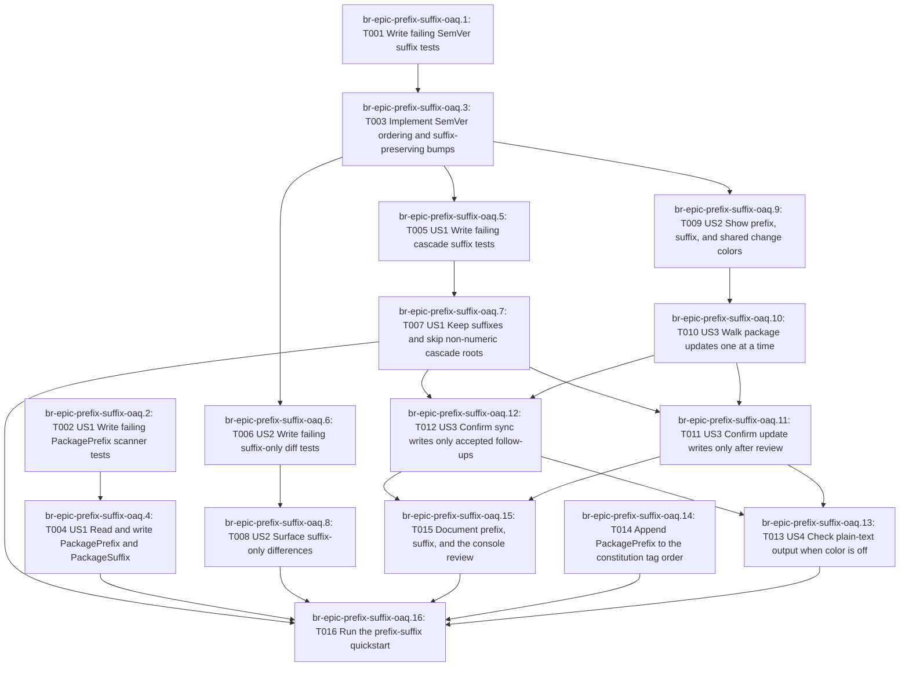

# Tasks: Package Prefix and Suffix Updates

> **Authority:** beads rust (`br`) is the canonical task graph. This file is a **generated projection**. Do not reverse-sync silent markdown edits into `br`. Never use `bd`.
>
> Feature label: `speckit:001-prefix-suffix-console`

## Parallel execution

Tasks marked `[P]` are currently ready and mutually unblocked per `br`:

- `br-epic-prefix-suffix-oaq.1`
- `br-epic-prefix-suffix-oaq.14`
- `br-epic-prefix-suffix-oaq.2`

## Task checklist

- [ ] [P] T001 `br-epic-prefix-suffix-oaq.1` T001 Write failing SemVer suffix tests — Add failing tests in tests/NugetPackageHelper.Core.Tests/SemVerTests.fs. Do not change production code in this task.
- [ ] T010 `br-epic-prefix-suffix-oaq.10` T010 [US3] Walk package updates one at a time — Edit src/NugetPackageHelper.Cli/Interactive.fs to match contracts/cli-review.md.
- [ ] T011 `br-epic-prefix-suffix-oaq.11` T011 [US3] Confirm update writes only after review — Edit src/NugetPackageHelper.Cli/Commands/Update.fs.
- [ ] T012 `br-epic-prefix-suffix-oaq.12` T012 [US3] Confirm sync writes only accepted follow-ups — Edit src/NugetPackageHelper.Cli/Commands/Sync.fs.
- [ ] T013 `br-epic-prefix-suffix-oaq.13` T013 [US4] Check plain-text output when color is off — Check src/NugetPackageHelper.Cli/Output.fs, src/NugetPackageHelper.Cli/Interactive.fs, src/NugetPackageHelper.Cli/Commands/Update.fs, and src/NugetPackageHelper.Cli/Commands/Sync.fs against contracts/cli-review.md.
- [ ] [P] T014 `br-epic-prefix-suffix-oaq.14` T014 Append PackagePrefix to the constitution tag order — Edit .specify/memory/constitution.md principle IV so the tag order reads PackageVersion, then Version, then VersionPrefix/VersionSuffix, then PackagePrefix/PackageSuffix. Do not reorder the first three pairs. The order is already accepted in the spec, so this edit does not wait for the scanner implementation.
- [ ] T015 `br-epic-prefix-suffix-oaq.15` T015 Document prefix, suffix, and the console review — Update docs/user-guide.md so update and sync examples show prefix and suffix, the interactive choices, the final confirmation, and that color is paired with MAJOR, MINOR, PATCH, and SUFFIX words. Write from contracts/cli-review.md and contracts/version-tags.md. Do not wait for the scanner implementation.
- [ ] T016 `br-epic-prefix-suffix-oaq.16` T016 Run the prefix-suffix quickstart — Run specs/001-prefix-suffix-console/quickstart.md. dotnet test --configuration Release must pass. Manual checks cover PackagePrefix writes, earlier-tag wins, suffix kept on a follow-up bump, interactive decline writes nothing, and NO_COLOR=1 prints words without ANSI escapes. This waits on the scanner implementation even though the constitution sentence does not.
- [ ] [P] T002 `br-epic-prefix-suffix-oaq.2` T002 [US1] Write failing PackagePrefix scanner tests — Add failing tests and fixtures under tests/NugetPackageHelper.Scanner.Tests/ProjectScannerTests.fs and tests/NugetPackageHelper.Scanner.Tests/Fixtures/projects/. Do not change ProjectScanner.fs in this task.
- [ ] T003 `br-epic-prefix-suffix-oaq.3` T003 Implement SemVer ordering and suffix-preserving bumps — Make tests/NugetPackageHelper.Core.Tests/SemVerTests.fs pass by editing src/NugetPackageHelper.Core/Types.fs and src/NugetPackageHelper.Core/SemVer.fs.
- [ ] T004 `br-epic-prefix-suffix-oaq.4` T004 [US1] Read and write PackagePrefix and PackageSuffix — Make the new ProjectScanner tests pass by editing src/NugetPackageHelper.Scanner/ProjectScanner.fs only.
- [ ] T005 `br-epic-prefix-suffix-oaq.5` T005 [US1] Write failing cascade suffix tests — Add failing tests in tests/NugetPackageHelper.Core.Tests/CascadeEngineTests.fs. Do not change CascadeEngine.fs in this task.
- [ ] T006 `br-epic-prefix-suffix-oaq.6` T006 [US2] Write failing suffix-only diff tests — Add failing tests in tests/NugetPackageHelper.Core.Tests/DiffEngineTests.fs. Do not change DiffEngine.fs in this task.
- [ ] T007 `br-epic-prefix-suffix-oaq.7` T007 [US1] Keep suffixes and skip non-numeric cascade roots — Make tests/NugetPackageHelper.Core.Tests/CascadeEngineTests.fs pass by editing src/NugetPackageHelper.Core/CascadeEngine.fs.
- [ ] T008 `br-epic-prefix-suffix-oaq.8` T008 [US2] Surface suffix-only differences — Make tests/NugetPackageHelper.Core.Tests/DiffEngineTests.fs pass. Edit src/NugetPackageHelper.Core/DiffEngine.fs only if suffix-only rows are still missing after T003.
- [ ] T009 `br-epic-prefix-suffix-oaq.9` T009 [US2] Show prefix, suffix, and shared change colors — Edit src/NugetPackageHelper.Cli/Output.fs so diff and proposal output show current prefix, current suffix or none, proposed prefix, proposed suffix or none, the change word, and the reason.

## Dependency graph

_Generated by core/skills/tasks-beads/scripts/Render-TasksFromBr.ps1_
