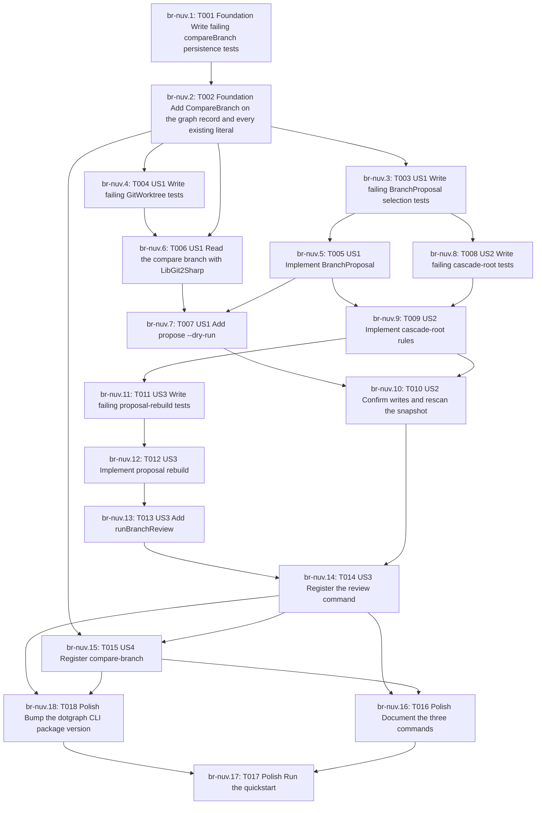

# Tasks: Branch Diff Version Bump

> **Authority:** beads rust (`br`) is the canonical task graph. This file is a **generated projection**. Do not reverse-sync silent markdown edits into `br`. Never use `bd`.
>
> Feature label: `speckit:002-branch-diff-bump`

## Parallel execution

_No parallel-ready batch right now (check `br ready`)._

## Task checklist

- [x] T001 `br-nuv.1` T001 [Foundation] Write failing compareBranch persistence tests — tests/NugetPackageHelper.Core.Tests/GraphPersistenceTests.fs
- [x] T010 `br-nuv.10` T010 [US2] Confirm writes and rescan the snapshot — src/NugetPackageHelper.Cli/Commands/Propose.fs
- [x] T011 `br-nuv.11` T011 [US3] Write failing proposal-rebuild tests — tests/NugetPackageHelper.Core.Tests/BranchProposalTests.fs
- [x] T012 `br-nuv.12` T012 [US3] Implement proposal rebuild — src/NugetPackageHelper.Core/BranchProposal.fs
- [x] T013 `br-nuv.13` T013 [US3] Add runBranchReview — src/NugetPackageHelper.Cli/Interactive.fs
- [x] T014 `br-nuv.14` T014 [US3] Register the review command — src/NugetPackageHelper.Cli/Commands/Review.fs, src/NugetPackageHelper.Cli/Program.fs, src/NugetPackageHelper.Cli/NugetPackageHelper.Cli.fsproj
- [x] T015 `br-nuv.15` T015 [US4] Register compare-branch — src/NugetPackageHelper.Cli/Commands/CompareBranch.fs, src/NugetPackageHelper.Cli/Program.fs
- [x] T016 `br-nuv.16` T016 [Polish] Document the three commands — docs/user-guide.md
- [x] T017 `br-nuv.17` T017 [Polish] Run the quickstart — specs/002-branch-diff-bump/quickstart.md
- [x] T018 `br-nuv.18` T018 [Polish] Bump the dotgraph CLI package version — src/NugetPackageHelper.Cli/NugetPackageHelper.Cli.fsproj
- [x] T002 `br-nuv.2` T002 [Foundation] Add CompareBranch on the graph record and every existing literal — src/NugetPackageHelper.Core/Types.fs, src/NugetPackageHelper.Core/GraphPersistence.fs, the DependencyGraph literal in src/NugetPackageHelper.Scanner/ProjectScanner.fs (buildGraph only), tests/NugetPackageHelper.Core.Tests/GraphTests.fs, DiffEngineTests.fs, CascadeEngineTests.fs, GraphPersistenceTests.fs
- [x] T003 `br-nuv.3` T003 [US1] Write failing BranchProposal selection tests — tests/NugetPackageHelper.Core.Tests/BranchProposalTests.fs
- [x] T004 `br-nuv.4` T004 [US1] Write failing GitWorktree tests — tests/NugetPackageHelper.Scanner.Tests/GitWorktreeTests.fs
- [x] T005 `br-nuv.5` T005 [US1] Implement BranchProposal — src/NugetPackageHelper.Core/BranchProposal.fs, src/NugetPackageHelper.Core/NugetPackageHelper.Core.fsproj
- [x] T006 `br-nuv.6` T006 [US1] Read the compare branch with LibGit2Sharp — src/NugetPackageHelper.Scanner/NugetPackageHelper.Scanner.fsproj, versionFromXml in src/NugetPackageHelper.Scanner/ProjectScanner.fs, src/NugetPackageHelper.Scanner/GitWorktree.fs
- [x] T007 `br-nuv.7` T007 [US1] Add propose --dry-run — src/NugetPackageHelper.Cli/Output.fs, src/NugetPackageHelper.Cli/Commands/Propose.fs, src/NugetPackageHelper.Cli/Program.fs, src/NugetPackageHelper.Cli/NugetPackageHelper.Cli.fsproj
- [x] T008 `br-nuv.8` T008 [US2] Write failing cascade-root tests — tests/NugetPackageHelper.Core.Tests/BranchProposalTests.fs
- [x] T009 `br-nuv.9` T009 [US2] Implement cascade-root rules — src/NugetPackageHelper.Core/BranchProposal.fs

## Dependency graph

_Generated by core/skills/tasks-beads/scripts/Render-TasksFromBr.ps1_
